# Results and Discussion

**Benchmarking Graph-Based Fraud Detection: Architecture Comparison Across Training Ratios, Datasets, Runtime and Complexity**

This document summarises experimental results from `results/`, interprets architecture–dataset interactions using model implementations in `algorithms/`, and situates datasets with statistics from `reference/Dataset_Report_Full.docx`. Static figures are produced by `docs/visualize_metrics.py` and `docs/visualize_runtime_complexity.py`; a Word version with embedded visuals is `docs/Results_and_Discussion.docx`.

---

## 1. Experimental setup

All methods share a fixed validation (20%) and test (40%) protocol; only the labeled training pool varies over **10%, 20%, 30% and 40%** (stratified seeds `123`–`1234567`). Scores are **mean ± std** over seeds. Metrics: **G-Mean**, **AUROC**, **AUPRC**, **Macro-F1**.

**Datasets (5):** Amazon, YelpChi, T-Finance, Elliptic, FDCompCN (T-Social excluded pending heterophily recomputation).

**Models:** BWGNN, GLHN, GraphConsis, PMP, SEC-GFD, BSL, DGA-GNN (full five-dataset coverage); SplitGNN (partial at 10%/40%); GAGA / GHRN (subset of datasets). GAGA/GHRN runs did not log Macro-F1 (shown as —).

---

## 2. Dataset characteristics and comparison

The collection spans four domains and largely **independent difficulty axes**: imbalance, local camouflage (heterophily), multi-relation structure, sparsity and scale ([Dataset Report](../reference/Dataset_Report_Full.docx)).

| Dataset | Nodes (fraud rate) | Features | Graph type | Local het. (union) | Distinctive challenge |
| --- | ---: | ---: | --- | ---: | --- |
| **YelpChi** | 45,954 (14.53%) | 32 | Multi-relation reviews | ~0.81 (severe; R-U-R only ~0.08) | Relation inconsistency / camouflage |
| **Amazon** | 11,944 (6.87% all / ~9.5% labeled) | 25 | Multi-relation users | ~0.90 (severe) | Extreme camouflage + unlabeled nodes |
| **T-Finance** | 39,357 (4.58%) | 10 | Dense homogeneous | ~0.46 (severe but milder) | Scale under density (~539 deg.) |
| **Elliptic** | 203,769 (2.23% all) | 166 | Sparse homogeneous | ~0.49 | Scale under sparsity; rich features |
| **FDCompCN** | 5,317 (10.51%) | 57 | Multi-relation, sparse | ~0.86 | Isolation (many degree-0 firms) |

**Table D1.** Dataset summary (statistics from Dataset_Report_Full; local heterophily corrected in that report).

### 2.1 Per-dataset notes

**YelpChi.** Same-reviewer links (R-U-R) are homophilic; same-product/time links are strongly heterophilic. Methods that average relations indiscriminately dilute the useful signal—the failure mode GraphConsis / CARE-style relation selection target.

**Amazon.** Musical-instrument reviewers with U-P-U / U-S-U / U-V-U relations and extreme local camouflage. Unlabeled users stay in the graph for message passing (GADBench convention).

**T-Finance.** Industrial transaction graph: anomalies partly cluster (lowest local heterophily here), but ~21M edges make epoch cost density-driven.

**Elliptic.** Bitcoin transactions treated as one static snapshot. Sparse (~1.15 edges/node); 166-d features already include one-hop aggregates, so GNN layers partly re-encode precomputed structure.

**FDCompCN.** Corporate disclosure graph (investment / supplier / customer). After removing self-loops the graph is extremely sparse; thousands of companies—including many fraud cases—have **no** business ties, so a GNN reduces to a feature classifier on those nodes.

### 2.2 Cross-dataset comparison

- **Camouflage vs rate:** Amazon (high camouflage, moderate fraud rate) vs YelpChi (high fraud rate, mixed relation heterophily) show that rarity and camouflage do not move together.
- **Density vs sparsity:** T-Finance and Elliptic are both “large” but opposite in density; runtime rankings flip accordingly.
- **Structure availability:** FDCompCN is the hardest stress test for *graph* methods because missing edges remove the inductive bias GNNs rely on; absolute AUPRC stays low for every model.

---

## 3. Performance tables by training ratio

Values are mean±std over seeds. Em dash (—) = missing coverage. Colour-coded static tables: **Figures 1–4** (`docs/figures/metrics_table_*pct.png`).

### 3.1 Table 1 — 10% training ratio

| Model | Amazon |  |  |  | YelpChi |  |  |  | T-Finance |  |  |  | Elliptic |  |  |  | FDCompCN |  |  |  |
| --- | --- | --- | --- | --- | --- | --- | --- | --- | --- | --- | --- | --- | --- | --- | --- | --- | --- | --- | --- | --- |
|  | G-Mean | AUROC | AUPRC | F1-Macro | G-Mean | AUROC | AUPRC | F1-Macro | G-Mean | AUROC | AUPRC | F1-Macro | G-Mean | AUROC | AUPRC | F1-Macro | G-Mean | AUROC | AUPRC | F1-Macro |
| BSL | 0.706±0.070 | 0.862±0.009 | 0.429±0.023 | 0.713±0.026 | 0.069±0.104 | 0.601±0.009 | 0.225±0.012 | 0.473±0.022 | 0.820±0.010 | 0.901±0.006 | 0.684±0.025 | 0.742±0.086 | 0.862±0.021 | 0.945±0.006 | 0.770±0.024 | 0.840±0.031 | 0.263±0.154 | 0.595±0.054 | 0.160±0.036 | 0.526±0.035 |
| BWGNN | 0.891±0.016 | 0.953±0.017 | 0.834±0.016 | 0.865±0.025 | 0.778±0.005 | 0.858±0.005 | 0.528±0.011 | 0.650±0.012 | 0.908±0.010 | 0.953±0.006 | 0.833±0.015 | 0.808±0.020 | 0.903±0.007 | 0.962±0.004 | 0.839±0.014 | 0.847±0.029 | 0.324±0.202 | 0.548±0.011 | 0.123±0.003 | 0.435±0.118 |
| DGA-GNN | 0.612±0.154 | 0.919±0.010 | 0.626±0.065 | 0.719±0.081 | 0.848±0.034 | 0.952±0.007 | 0.820±0.031 | 0.854±0.015 | 0.845±0.040 | 0.949±0.009 | 0.771±0.069 | 0.859±0.035 | 0.916±0.012 | 0.967±0.010 | 0.899±0.043 | 0.938±0.007 | 0.232±0.168 | 0.712±0.030 | 0.263±0.069 | 0.533±0.057 |
| GAGA | 0.886±0.010 | 0.952±0.014 | 0.829±0.019 | — | — | — | — | — | — | — | — | — | — | — | — | — | 0.506±0.021 | 0.507±0.029 | 0.117±0.008 | — |
| GHRN | 0.890±0.007 | 0.955±0.008 | 0.832±0.024 | — | 0.696±0.030 | 0.793±0.008 | 0.430±0.005 | — | — | — | — | — | — | — | — | — | 0.358±0.191 | 0.559±0.030 | 0.134±0.016 | — |
| GLHN | 0.848±0.015 | 0.936±0.007 | 0.752±0.019 | 0.742±0.050 | 0.783±0.005 | 0.858±0.007 | 0.572±0.018 | 0.701±0.010 | 0.894±0.002 | 0.948±0.003 | 0.814±0.012 | 0.790±0.044 | 0.869±0.012 | 0.941±0.009 | 0.755±0.038 | 0.810±0.021 | 0.469±0.039 | 0.604±0.041 | 0.164±0.038 | 0.509±0.102 |
| GraphConsis | 0.870±0.010 | 0.965±0.009 | 0.845±0.021 | 0.894±0.008 | 0.720±0.030 | 0.883±0.002 | 0.630±0.009 | 0.756±0.009 | 0.863±0.015 | 0.948±0.007 | 0.827±0.013 | 0.890±0.008 | 0.877±0.015 | 0.961±0.004 | 0.853±0.010 | 0.891±0.005 | 0.269±0.161 | 0.611±0.056 | 0.177±0.048 | 0.529±0.039 |
| PMP | 0.868±0.009 | 0.956±0.009 | 0.864±0.019 | 0.901±0.008 | 0.680±0.079 | 0.896±0.004 | 0.629±0.011 | 0.737±0.023 | 0.863±0.016 | 0.957±0.010 | 0.869±0.012 | 0.910±0.006 | 0.819±0.078 | 0.924±0.004 | 0.710±0.029 | 0.851±0.039 | 0.305±0.252 | 0.550±0.027 | 0.132±0.021 | 0.410±0.093 |
| SEC-GFD | 0.876±0.016 | 0.945±0.015 | 0.845±0.024 | 0.880±0.017 | 0.705±0.006 | 0.787±0.005 | 0.423±0.011 | 0.613±0.035 | 0.886±0.050 | 0.936±0.039 | 0.711±0.250 | 0.726±0.081 | 0.896±0.010 | 0.957±0.004 | 0.825±0.031 | 0.873±0.020 | 0.363±0.209 | 0.564±0.020 | 0.127±0.007 | 0.423±0.099 |
| SplitGNN | — | — | — | — | — | — | — | — | — | — | — | — | — | — | — | — | — | — | — | — |

**Table 1.** Test metrics at 10% training ratio (mean ± std).

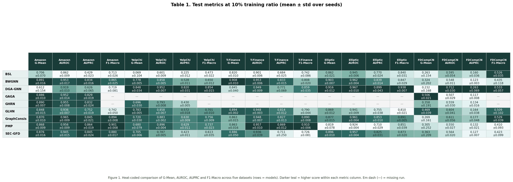

*Figure 1. Heat-coded comparison of G-Mean, AUROC, AUPRC and F1-Macro at 10% train (darker teal = higher score within each metric column).*

### 3.2 Table 2 — 20% training ratio

| Model | Amazon |  |  |  | YelpChi |  |  |  | T-Finance |  |  |  | Elliptic |  |  |  | FDCompCN |  |  |  |
| --- | --- | --- | --- | --- | --- | --- | --- | --- | --- | --- | --- | --- | --- | --- | --- | --- | --- | --- | --- | --- |
|  | G-Mean | AUROC | AUPRC | F1-Macro | G-Mean | AUROC | AUPRC | F1-Macro | G-Mean | AUROC | AUPRC | F1-Macro | G-Mean | AUROC | AUPRC | F1-Macro | G-Mean | AUROC | AUPRC | F1-Macro |
| BSL | 0.758±0.010 | 0.868±0.012 | 0.437±0.018 | 0.708±0.017 | 0.056±0.054 | 0.600±0.005 | 0.226±0.008 | 0.466±0.007 | 0.825±0.018 | 0.901±0.005 | 0.690±0.018 | 0.761±0.054 | 0.871±0.008 | 0.943±0.007 | 0.755±0.040 | 0.813±0.044 | 0.378±0.065 | 0.620±0.025 | 0.179±0.025 | 0.551±0.025 |
| BWGNN | 0.903±0.016 | 0.967±0.004 | 0.842±0.006 | 0.858±0.028 | 0.796±0.006 | 0.872±0.005 | 0.564±0.013 | 0.686±0.018 | 0.906±0.012 | 0.955±0.004 | 0.830±0.011 | 0.757±0.063 | 0.919±0.002 | 0.971±0.002 | 0.884±0.006 | 0.873±0.006 | 0.447±0.097 | 0.559±0.011 | 0.136±0.010 | 0.452±0.075 |
| DGA-GNN | 0.744±0.091 | 0.936±0.021 | 0.692±0.147 | 0.808±0.078 | 0.884±0.028 | 0.969±0.003 | 0.888±0.014 | 0.885±0.008 | 0.851±0.034 | 0.954±0.006 | 0.824±0.040 | 0.887±0.018 | 0.925±0.007 | 0.978±0.011 | 0.940±0.017 | 0.947±0.009 | 0.346±0.046 | 0.747±0.012 | 0.336±0.014 | 0.572±0.020 |
| GAGA | 0.893±0.009 | 0.952±0.008 | 0.842±0.016 | — | — | — | — | — | — | — | — | — | — | — | — | — | 0.515±0.022 | 0.529±0.024 | 0.134±0.018 | — |
| GHRN | 0.896±0.010 | 0.960±0.006 | 0.840±0.015 | — | 0.724±0.025 | 0.811±0.015 | 0.466±0.029 | — | — | — | — | — | — | — | — | — | 0.363±0.176 | 0.565±0.014 | 0.140±0.019 | — |
| GLHN | 0.878±0.034 | 0.946±0.014 | 0.811±0.041 | 0.788±0.081 | 0.798±0.007 | 0.871±0.005 | 0.595±0.010 | 0.708±0.020 | 0.900±0.007 | 0.952±0.004 | 0.820±0.016 | 0.786±0.017 | 0.895±0.009 | 0.956±0.007 | 0.812±0.026 | 0.826±0.017 | 0.546±0.018 | 0.648±0.023 | 0.207±0.013 | 0.580±0.016 |
| GraphConsis | 0.883±0.024 | 0.968±0.003 | 0.848±0.027 | 0.895±0.012 | 0.724±0.047 | 0.890±0.024 | 0.662±0.045 | 0.768±0.026 | 0.872±0.025 | 0.953±0.005 | 0.841±0.007 | 0.894±0.004 | 0.892±0.004 | 0.968±0.002 | 0.885±0.013 | 0.909±0.006 | 0.385±0.152 | 0.667±0.014 | 0.223±0.013 | 0.570±0.048 |
| PMP | 0.874±0.018 | 0.968±0.008 | 0.879±0.014 | 0.911±0.006 | 0.729±0.038 | 0.917±0.004 | 0.706±0.013 | 0.779±0.007 | 0.880±0.014 | 0.967±0.006 | 0.884±0.015 | 0.917±0.007 | 0.888±0.017 | 0.942±0.006 | 0.784±0.009 | 0.891±0.010 | 0.097±0.090 | 0.562±0.029 | 0.141±0.006 | 0.486±0.014 |
| SEC-GFD | 0.899±0.017 | 0.964±0.005 | 0.871±0.009 | 0.877±0.015 | 0.731±0.016 | 0.814±0.013 | 0.485±0.022 | 0.629±0.045 | 0.896±0.061 | 0.947±0.029 | 0.764±0.180 | 0.783±0.068 | 0.915±0.004 | 0.968±0.001 | 0.863±0.008 | 0.846±0.023 | 0.384±0.161 | 0.556±0.024 | 0.123±0.011 | 0.387±0.172 |
| SplitGNN | 0.818±0.028 | 0.891±0.019 | 0.555±0.026 | 0.687±0.051 | 0.815±0.005 | 0.890±0.005 | 0.641±0.024 | 0.716±0.010 | 0.919±0.012 | 0.953±0.009 | 0.859±0.019 | 0.819±0.013 | 0.878±0.011 | 0.944±0.007 | 0.736±0.041 | 0.760±0.021 | 0.398±0.228 | 0.563±0.041 | 0.137±0.029 | 0.349±0.168 |

**Table 2.** Test metrics at 20% training ratio (mean ± std).

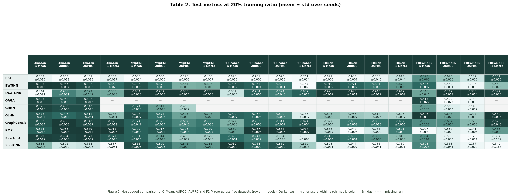

*Figure 2. Heat-coded metric table at 20% training ratio.*

### 3.3 Table 3 — 30% training ratio

| Model | Amazon |  |  |  | YelpChi |  |  |  | T-Finance |  |  |  | Elliptic |  |  |  | FDCompCN |  |  |  |
| --- | --- | --- | --- | --- | --- | --- | --- | --- | --- | --- | --- | --- | --- | --- | --- | --- | --- | --- | --- | --- |
|  | G-Mean | AUROC | AUPRC | F1-Macro | G-Mean | AUROC | AUPRC | F1-Macro | G-Mean | AUROC | AUPRC | F1-Macro | G-Mean | AUROC | AUPRC | F1-Macro | G-Mean | AUROC | AUPRC | F1-Macro |
| BSL | 0.617±0.251 | 0.865±0.014 | 0.428±0.023 | 0.643±0.081 | 0.034±0.048 | 0.603±0.008 | 0.225±0.012 | 0.464±0.004 | 0.826±0.015 | 0.902±0.005 | 0.691±0.006 | 0.732±0.073 | 0.797±0.110 | 0.942±0.006 | 0.759±0.025 | 0.816±0.042 | 0.273±0.121 | 0.632±0.028 | 0.193±0.024 | 0.525±0.030 |
| BWGNN | 0.910±0.008 | 0.973±0.002 | 0.845±0.014 | 0.842±0.020 | 0.803±0.006 | 0.883±0.006 | 0.595±0.013 | 0.687±0.016 | 0.916±0.007 | 0.958±0.004 | 0.843±0.020 | 0.789±0.058 | 0.927±0.002 | 0.976±0.002 | 0.899±0.004 | 0.870±0.019 | 0.471±0.129 | 0.594±0.058 | 0.159±0.042 | 0.436±0.092 |
| DGA-GNN | 0.817±0.015 | 0.959±0.007 | 0.817±0.054 | 0.869±0.022 | 0.887±0.055 | 0.974±0.008 | 0.906±0.022 | 0.895±0.021 | 0.828±0.040 | 0.957±0.007 | 0.814±0.068 | 0.883±0.031 | 0.926±0.014 | 0.986±0.005 | 0.958±0.011 | 0.954±0.006 | 0.354±0.145 | 0.769±0.013 | 0.352±0.044 | 0.582±0.061 |
| GAGA | 0.898±0.010 | 0.963±0.006 | 0.856±0.025 | — | — | — | — | — | — | — | — | — | — | — | — | — | 0.527±0.033 | 0.546±0.047 | 0.135±0.032 | — |
| GHRN | 0.903±0.014 | 0.968±0.003 | 0.857±0.017 | — | 0.737±0.024 | 0.825±0.013 | 0.500±0.041 | — | — | — | — | — | — | — | — | — | 0.358±0.230 | 0.588±0.022 | 0.157±0.022 | — |
| GLHN | 0.899±0.017 | 0.956±0.015 | 0.849±0.022 | 0.843±0.007 | 0.808±0.003 | 0.880±0.003 | 0.618±0.010 | 0.716±0.010 | 0.902±0.005 | 0.956±0.004 | 0.825±0.017 | 0.810±0.019 | 0.902±0.010 | 0.961±0.008 | 0.835±0.032 | 0.853±0.016 | 0.585±0.024 | 0.658±0.014 | 0.208±0.014 | 0.561±0.014 |
| GraphConsis | 0.895±0.009 | 0.973±0.006 | 0.876±0.009 | 0.907±0.009 | 0.734±0.021 | 0.903±0.017 | 0.698±0.036 | 0.781±0.015 | 0.880±0.018 | 0.960±0.003 | 0.853±0.006 | 0.895±0.008 | 0.901±0.009 | 0.975±0.004 | 0.905±0.014 | 0.915±0.005 | 0.407±0.066 | 0.697±0.008 | 0.273±0.016 | 0.590±0.028 |
| PMP | 0.886±0.024 | 0.974±0.002 | 0.897±0.009 | 0.913±0.003 | 0.745±0.051 | 0.929±0.003 | 0.746±0.013 | 0.793±0.016 | 0.867±0.037 | 0.968±0.007 | 0.887±0.020 | 0.912±0.015 | 0.822±0.145 | 0.939±0.014 | 0.755±0.078 | 0.850±0.083 | 0.140±0.206 | 0.540±0.030 | 0.126±0.015 | 0.443±0.080 |
| SEC-GFD | 0.896±0.015 | 0.963±0.005 | 0.865±0.016 | 0.881±0.025 | 0.754±0.011 | 0.837±0.011 | 0.537±0.023 | 0.643±0.018 | 0.917±0.009 | 0.954±0.009 | 0.839±0.025 | 0.809±0.024 | 0.920±0.005 | 0.973±0.002 | 0.876±0.010 | 0.863±0.024 | 0.366±0.180 | 0.558±0.021 | 0.128±0.016 | 0.289±0.162 |
| SplitGNN | 0.829±0.023 | 0.907±0.014 | 0.574±0.039 | 0.713±0.016 | 0.821±0.006 | 0.902±0.004 | 0.666±0.014 | 0.720±0.010 | 0.921±0.007 | 0.958±0.005 | 0.864±0.015 | 0.817±0.021 | 0.889±0.013 | 0.954±0.006 | 0.787±0.039 | 0.777±0.027 | 0.402±0.229 | 0.558±0.047 | 0.136±0.034 | 0.358±0.171 |

**Table 3.** Test metrics at 30% training ratio (mean ± std).

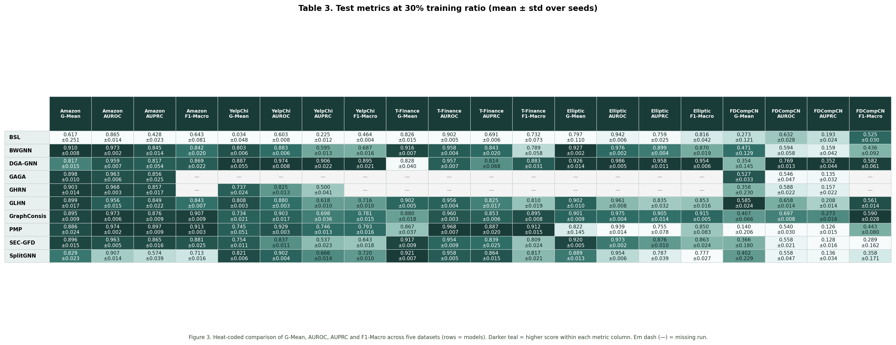

*Figure 3. Heat-coded metric table at 30% training ratio.*

### 3.4 Table 4 — 40% training ratio

| Model | Amazon |  |  |  | YelpChi |  |  |  | T-Finance |  |  |  | Elliptic |  |  |  | FDCompCN |  |  |  |
| --- | --- | --- | --- | --- | --- | --- | --- | --- | --- | --- | --- | --- | --- | --- | --- | --- | --- | --- | --- | --- |
|  | G-Mean | AUROC | AUPRC | F1-Macro | G-Mean | AUROC | AUPRC | F1-Macro | G-Mean | AUROC | AUPRC | F1-Macro | G-Mean | AUROC | AUPRC | F1-Macro | G-Mean | AUROC | AUPRC | F1-Macro |
| BSL | 0.576±0.334 | 0.861±0.017 | 0.432±0.026 | 0.653±0.102 | 0.040±0.042 | 0.605±0.009 | 0.230±0.013 | 0.464±0.004 | 0.824±0.018 | 0.902±0.007 | 0.692±0.022 | 0.756±0.090 | 0.842±0.043 | 0.941±0.006 | 0.746±0.050 | 0.829±0.025 | 0.297±0.103 | 0.622±0.029 | 0.179±0.026 | 0.529±0.028 |
| BWGNN | 0.916±0.004 | 0.977±0.003 | 0.862±0.011 | 0.852±0.012 | 0.812±0.008 | 0.891±0.009 | 0.608±0.017 | 0.702±0.010 | 0.922±0.006 | 0.960±0.005 | 0.857±0.019 | 0.827±0.015 | 0.931±0.003 | 0.979±0.001 | 0.909±0.006 | 0.881±0.011 | 0.448±0.151 | 0.573±0.028 | 0.143±0.025 | 0.362±0.150 |
| DGA-GNN | 0.769±0.089 | 0.957±0.014 | 0.784±0.091 | 0.834±0.068 | 0.916±0.027 | 0.980±0.005 | 0.928±0.017 | 0.914±0.014 | 0.826±0.033 | 0.956±0.007 | 0.814±0.053 | 0.882±0.019 | 0.933±0.012 | 0.988±0.004 | 0.963±0.007 | 0.957±0.005 | 0.377±0.030 | 0.784±0.019 | 0.381±0.022 | 0.589±0.014 |
| GAGA | 0.908±0.005 | 0.968±0.003 | 0.863±0.010 | — | — | — | — | — | — | — | — | — | — | — | — | — | 0.544±0.063 | 0.563±0.069 | 0.148±0.044 | — |
| GHRN | 0.915±0.006 | 0.974±0.002 | 0.871±0.019 | — | 0.755±0.016 | 0.843±0.010 | 0.531±0.023 | — | — | — | — | — | — | — | — | — | 0.458±0.098 | 0.563±0.018 | 0.136±0.014 | — |
| GLHN | 0.908±0.012 | 0.962±0.006 | 0.862±0.013 | 0.852±0.006 | 0.817±0.003 | 0.889±0.003 | 0.643±0.007 | 0.729±0.009 | 0.904±0.005 | 0.958±0.005 | 0.831±0.020 | 0.815±0.031 | 0.914±0.008 | 0.968±0.005 | 0.870±0.016 | 0.856±0.016 | 0.598±0.030 | 0.681±0.020 | 0.225±0.025 | 0.573±0.008 |
| GraphConsis | 0.886±0.012 | 0.976±0.004 | 0.868±0.018 | 0.907±0.006 | 0.757±0.024 | 0.914±0.020 | 0.716±0.040 | 0.791±0.018 | 0.864±0.024 | 0.961±0.003 | 0.853±0.006 | 0.899±0.010 | 0.912±0.012 | 0.978±0.002 | 0.915±0.007 | 0.922±0.003 | 0.371±0.051 | 0.699±0.018 | 0.281±0.015 | 0.575±0.019 |
| PMP | 0.867±0.016 | 0.979±0.003 | 0.912±0.012 | 0.912±0.005 | 0.776±0.045 | 0.938±0.004 | 0.773±0.014 | 0.812±0.018 | 0.865±0.035 | 0.969±0.005 | 0.890±0.015 | 0.911±0.015 | 0.884±0.015 | 0.940±0.007 | 0.790±0.035 | 0.899±0.015 | 0.253±0.235 | 0.544±0.038 | 0.125±0.014 | 0.408±0.103 |
| SEC-GFD | 0.903±0.013 | 0.970±0.007 | 0.877±0.020 | 0.878±0.016 | 0.767±0.012 | 0.849±0.013 | 0.564±0.031 | 0.668±0.020 | 0.919±0.007 | 0.959±0.005 | 0.836±0.041 | 0.809±0.035 | 0.926±0.004 | 0.977±0.002 | 0.892±0.004 | 0.871±0.017 | 0.486±0.098 | 0.605±0.037 | 0.153±0.018 | 0.411±0.136 |
| SplitGNN | — | — | — | — | 0.792±0.047 | 0.873±0.046 | 0.588±0.132 | 0.679±0.059 | — | — | — | — | 0.640±0.000 | 0.758±0.000 | 0.301±0.000 | 0.478±0.000 | 0.475±0.004 | 0.569±0.004 | 0.130±0.008 | 0.362±0.088 |

**Table 4.** Test metrics at 40% training ratio (mean ± std).

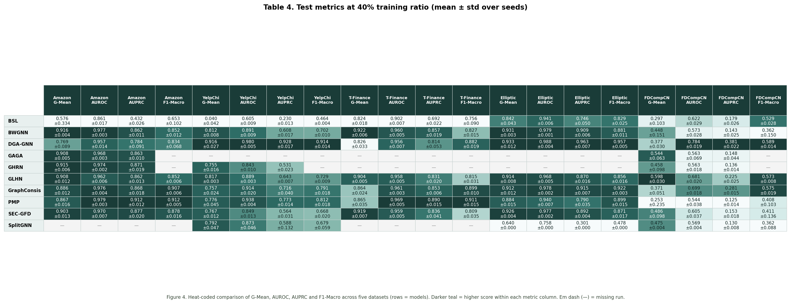

*Figure 4. Heat-coded metric table at 40% training ratio.*

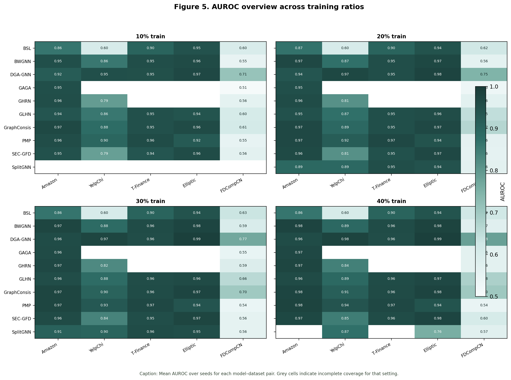

*Figure 5. AUROC overview heatmaps across all training ratios.*

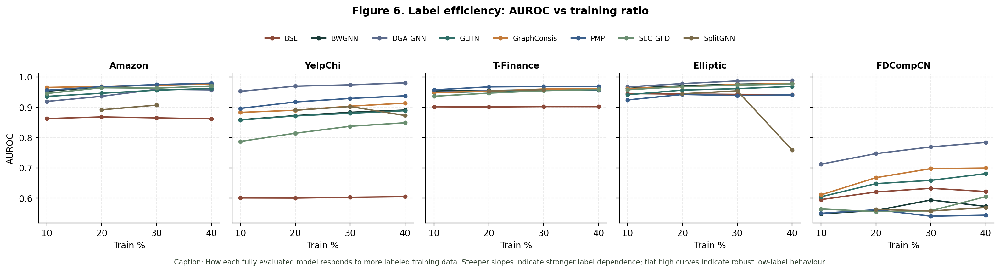

*Figure 6. Label efficiency: AUROC vs training ratio for fully covered models.*

---

## 4. Architecture comparison and interpretation

### 4.1 Model families (from `algorithms/`)

| Family | Models | Core inductive bias |
| --- | --- | --- |
| Spectral / wavelet | BWGNN, SplitGNN, SEC-GFD | Band-pass / signed filters for anomaly frequency content |
| Relation-aware MP | GraphConsis, PMP | Consistency / prototypes across multi-relation neighbourhoods |
| Homophily mixing | GLHN | Predicted local homophily mixes low- and high-pass filters |
| Grouped aggregation | DGA-GNN | Decision-tree bins + dynamic neighbour groups + attention |
| Barely supervised | BSL | NA/AA/NN disentanglement + weak/strong unlabeled views |
| Compact / efficient | GAGA, GHRN (partial) | Lightweight variants evaluated on subset of graphs |

### 4.2 Why some models win on some datasets

**Multi-relation camouflage (YelpChi, Amazon).**  
DGA-GNN leads YelpChi at every ratio (AUROC ≈0.95→0.98, AUPRC ≈0.82→0.93): grouping aggregation limits dilution from heterophilic product/time links. GraphConsis and PMP dominate Amazon ranking quality and thresholded F1—consistent with designs aimed at relation inconsistency and camouflaged neighbours. Plain spectral filters (BWGNN) remain strong on Amazon G-Mean/AUROC but trail on YelpChi AUPRC, where relation selection matters more than global spectrum.

**Dense mild-heterophily transactions (T-Finance).**  
Most full-coverage models saturate high AUROC (~0.95–0.97). Rankings shift to AUPRC/F1 (PMP, GraphConsis, BWGNN) and to **runtime**: GraphConsis (~7 s/epoch) and SplitGNN (~6 s/epoch) pay for density; SEC-GFD (~0.33 s/epoch) offers a strong accuracy–cost trade-off.

**Sparse large graph (Elliptic).**  
DGA-GNN and BWGNN top AUROC/AUPRC; rich node features plus sparse topology favour models that do not assume dense homophily. SplitGNN’s incomplete/weak 40% Elliptic run illustrates sensitivity to sparsity and coverage gaps.

**Isolated sparse corporate graph (FDCompCN).**  
Absolute scores collapse (AUPRC often <0.40). DGA-GNN leads AUROC/AUPRC; GLHN leads G-Mean—methods that degrade toward feature-driven decisions when neighbourhoods vanish. Structure-heavy filters cannot invent missing business ties; isolation, not just heterophily, is the bottleneck.

**Low-label regimes (10%).**  
BWGNN retains Amazon/T-Finance/Elliptic AUROC >0.95 with few labels (spectral prior). BSL helps on Elliptic/T-Finance under scarce labels but **fails on YelpChi** (AUROC ≈0.60): unlabeled augmentations do not replace relation-selective modelling when camouflage is relation-specific.

### 4.3 Label efficiency

Figure 6 shows shallow AUROC slopes for BWGNN/SEC-GFD/GraphConsis on Amazon and Elliptic (already strong at 10%), steeper gains for DGA-GNN on YelpChi/FDCompCN as labels increase, and flat-low BSL on YelpChi (more labels do not fix a mismatched assumption).

---

## 5. Runtime and parameter complexity

Per-epoch time is estimated as `train_time_sec / epochs_run`, where `epochs_run` uses logged `epochs_executed` when present, otherwise `min(epochs, best_epoch + early_stop)`.

### Table 5 — Average per-epoch training time (seconds)

| Model | Amazon | YelpChi | T-Finance | Elliptic | FDCompCN |
| --- | --- | --- | --- | --- | --- |
| BSL | 0.098 | 0.098 | 0.455 | 0.024 | 0.016 |
| BWGNN | 0.354 | 0.028 | 1.759 | 0.032 | 0.015 |
| DGA-GNN | 0.768 | 0.435 | 1.923 | 0.085 | 0.023 |
| GAGA | 0.155 | — | — | — | 0.327 |
| GHRN | 1.729 | 1.361 | — | — | 0.041 |
| GLHN | 0.391 | 0.413 | 0.907 | 0.056 | 0.090 |
| GraphConsis | 1.047 | 3.028 | 7.065 | 0.290 | 0.079 |
| PMP | 5.917 | 2.129 | 3.519 | 0.329 | 0.130 |
| SEC-GFD | 0.078 | 0.080 | 0.330 | 0.017 | 0.021 |
| SplitGNN | 0.807 | 0.750 | 6.269 | 0.023 | 0.050 |

**Table 5.** Mean wall-clock seconds per training epoch (averaged over seeds and training ratios).

### Table 6 — Trainable parameter counts

| Model | Amazon | YelpChi | T-Finance | Elliptic | FDCompCN |
| --- | --- | --- | --- | --- | --- |
| BSL | 15,107 | 15,779 | 13,667 | 28,643 | 18,179 |
| BWGNN | 30,594 | 31,042 | 29,634 | 39,618 | 32,642 |
| DGA-GNN | 371,358 | 147,684 | 43,236 | 304,497 | 106,916 |
| GAGA | 7,218 | — | — | — | 7,730 |
| GHRN | 18,306 | 18,754 | — | — | 20,354 |
| GLHN | 7,254 | 8,514 | 5,214 | 70,422 | 14,614 |
| GraphConsis | 119,170 | 124,546 | 36,226 | 76,162 | 143,746 |
| PMP | 67,529 | 241,795 | 8,051 | 335,843 | 943,177 |
| SEC-GFD | 29,787 | 31,138 | 26,892 | 9,768 | 35,963 |
| SplitGNN | 2,315 | 2,379 | 875 | 2,123 | 2,963 |

**Table 6.** Mean trainable parameter counts by model and dataset.

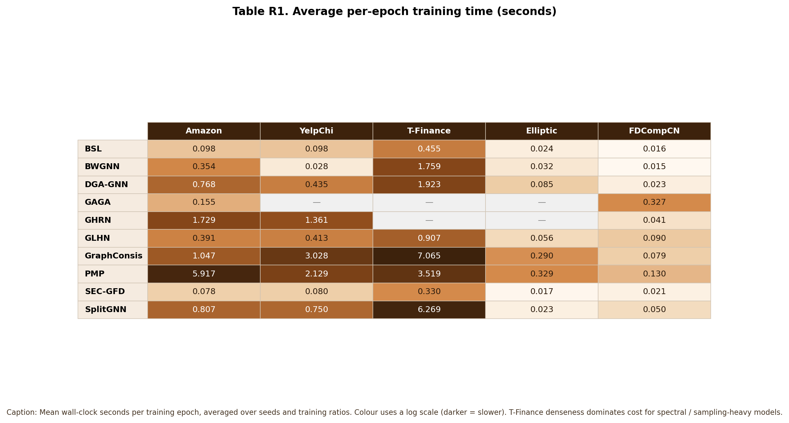

*Figure 7. Visual table of average per-epoch training time (seconds); darker = slower (log colour scale).*

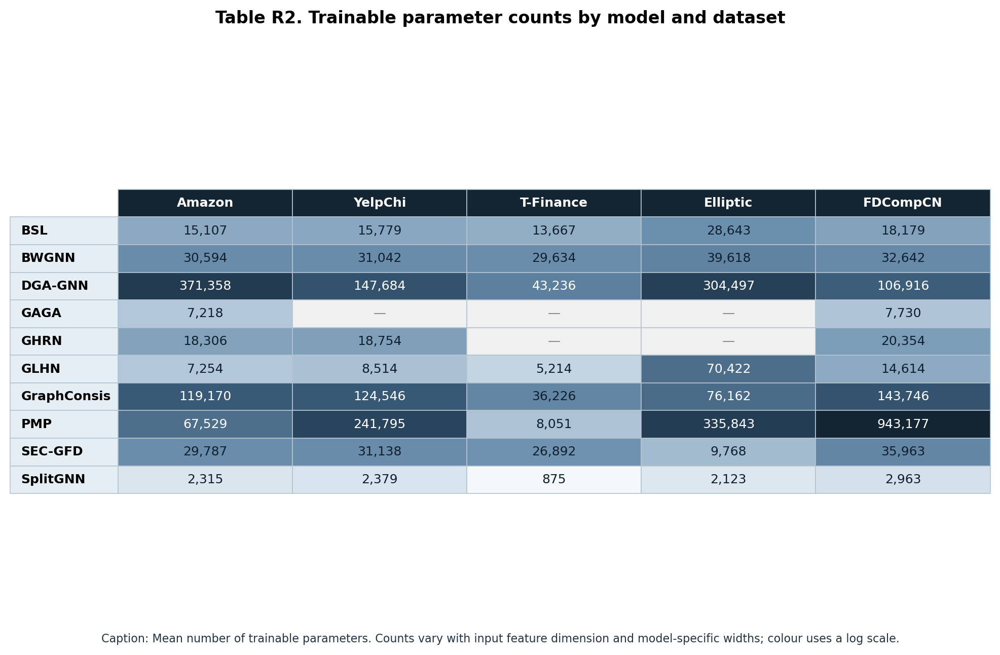

*Figure 8. Visual table of trainable parameter counts (log colour scale).*

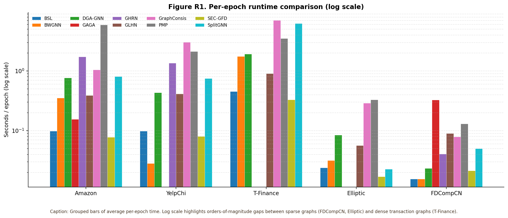

*Figure 9. Grouped per-epoch runtime bars (log scale).*

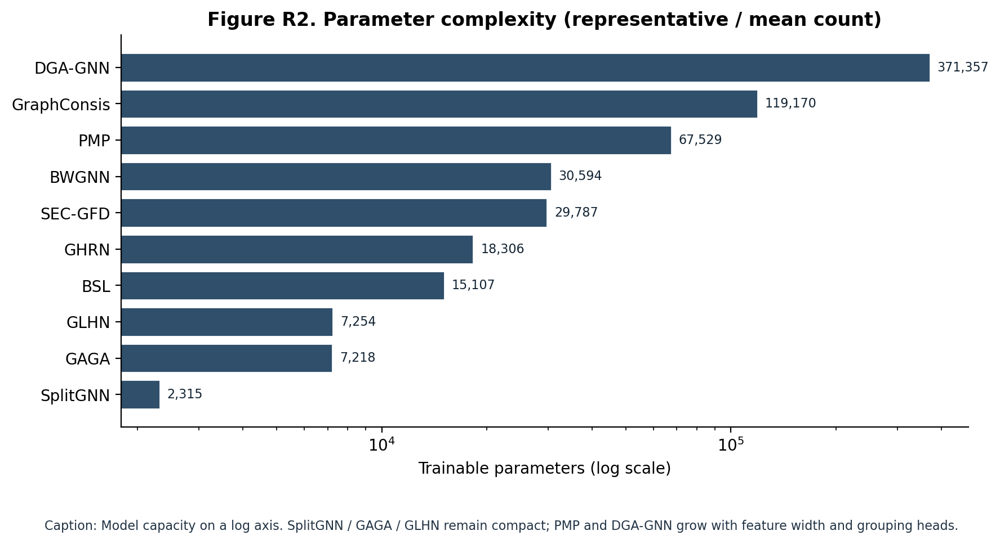

*Figure 10. Parameter complexity comparison (log scale).*

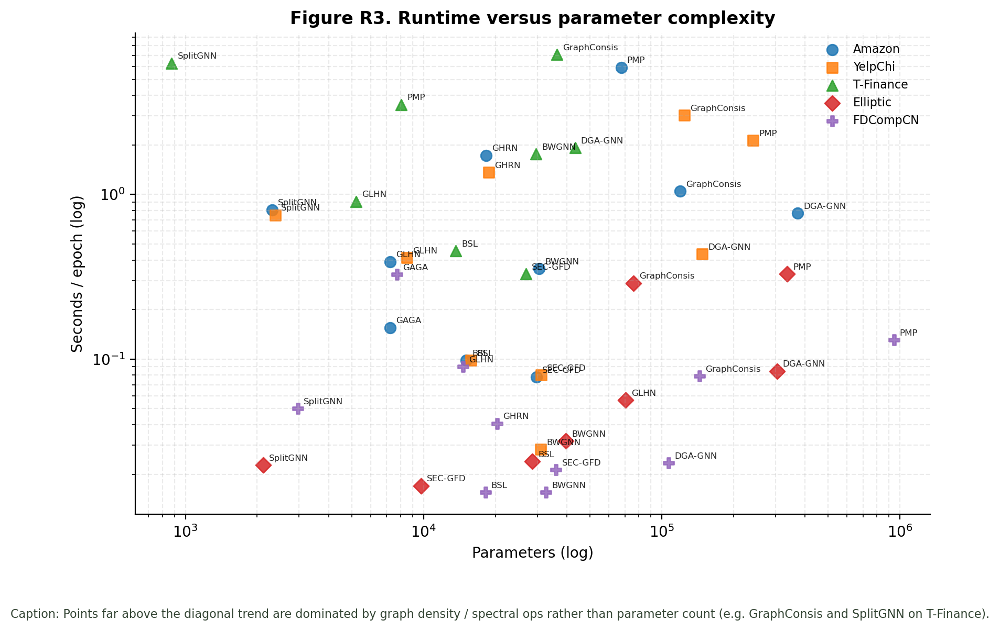

*Figure 11. Runtime versus parameter complexity by dataset. Points above the capacity trend are density-/spectral-dominated (e.g. GraphConsis, SplitGNN on T-Finance).*

**Takeaway:** Epoch cost tracks **graph density and operator cost** more than parameter count. SEC-GFD and BSL are consistently fast; PMP/GraphConsis/GHRN are expensive on dense multi-relation graphs; SplitGNN is parameter-compact but can still be slow on T-Finance.

---

## 6. Conclusions

1. **No universal winner** — match the model family to the dominant pathology (camouflage, density, sparsity, isolation).
2. **BWGNN** is a strong, label-efficient spectral baseline on Amazon / T-Finance / Elliptic.
3. **DGA-GNN / GraphConsis / PMP** unlock multi-relation and heterophilic settings (especially YelpChi; Amazon F1/AUPRC).
4. **GLHN / SEC-GFD** offer balanced accuracy–cost trade-offs; SEC-GFD is the efficiency standout.
5. **BSL** is assumption-sensitive and fails when relation camouflage dominates (YelpChi).
6. **FDCompCN** remains hard for all GNNs because isolation removes graph signal—report node coverage alongside scores.

---

## 7. Reproducing figures and the Word report

```powershell
# from repo root
python docs/aggregate_results.py
python docs/visualize_metrics.py
python docs/visualize_runtime_complexity.py
python docs/generate_word_report.py
```

Outputs: `docs/data/*`, `docs/figures/*`, `docs/Results_and_Discussion.docx`.
